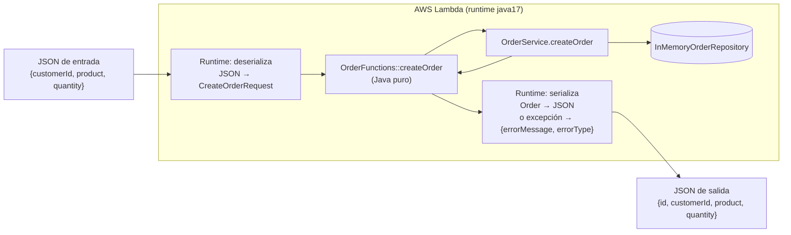
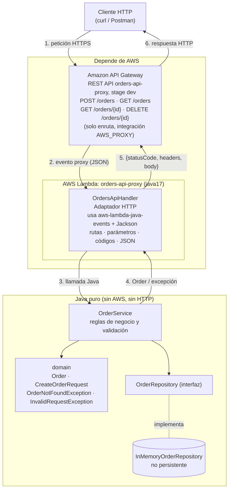
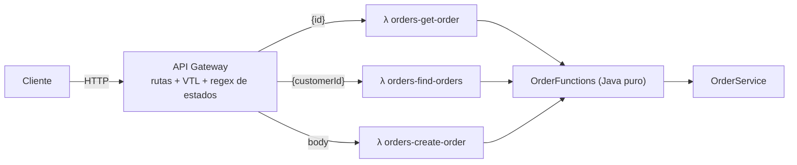

# Orders API — API REST serverless con AWS Lambda y API Gateway

API REST pequeña para gestionar pedidos (*orders*), construida en Java 17 + Maven y expuesta con AWS Lambda y Amazon API Gateway. El taller compara dos formas de conectar HTTP con Lambda (integración con *mapping templates* vs. integración *proxy*) y analiza dónde debe vivir cada responsabilidad.

## 1. Diseño de la API (contrato)

Se diseñó antes de escribir código Java.

### Representación de un pedido

```json
{
  "id": "ORD-001",
  "customerId": "CUST-42",
  "product": "MacBook Air",
  "quantity": 1
}
```

| Campo        | Tipo    | Regla                                   |
|--------------|---------|-----------------------------------------|
| `id`         | string  | Lo asigna el servidor (`ORD-NNN`)        |
| `customerId` | string  | Obligatorio, no vacío                   |
| `product`    | string  | Obligatorio, no vacío                   |
| `quantity`   | integer | Obligatorio, mayor que 0                |

### Formato de error (igual para todos los errores)

```json
{
  "error": "ORDER_NOT_FOUND",
  "message": "Order ORD-999 does not exist"
}
```

- `error`: código estable en MAYÚSCULAS, pensado para que lo lea un programa (`ORDER_NOT_FOUND`, `INVALID_REQUEST`, `INTERNAL_ERROR`, `ROUTE_NOT_FOUND`).
- `message`: explicación para una persona. Nunca incluye trazas de pila ni detalles internos.

### Operaciones

| Operación | Método y URL | Parámetros | Cuerpo de la petición | Éxito | Errores |
|---|---|---|---|---|---|
| Crear pedido | `POST /orders` | — | `{"customerId","product","quantity"}` | `201 Created` + pedido creado + header `Location: /orders/{id}` | `400 INVALID_REQUEST` (cuerpo ausente, JSON inválido, campos faltantes o inválidos), `500 INTERNAL_ERROR` |
| Consultar pedido | `GET /orders/{id}` | path: `id` | — | `200 OK` + pedido | `404 ORDER_NOT_FOUND`, `500 INTERNAL_ERROR` |
| Pedidos de un cliente | `GET /orders?customerId={customerId}` | query: `customerId` (obligatorio) | — | `200 OK` + arreglo de pedidos (puede ser `[]`) | `400 INVALID_REQUEST` (falta `customerId`), `500 INTERNAL_ERROR` |
| Eliminar pedido (extensión) | `DELETE /orders/{id}` | path: `id` | — | `204 No Content`, sin cuerpo | `404 ORDER_NOT_FOUND`, `500 INTERNAL_ERROR` |

Decisiones:

- Un cliente sin pedidos devuelve `200 OK` con `[]`, no `404`: la búsqueda se ejecutó bien y su resultado es una colección vacía.
- `GET /orders` sin `customerId` devuelve `400`. Listar todos los pedidos no forma parte del contrato.
- El cliente no envía `id` en el `POST`; si lo envía, la petición se rechaza con `400` (campo desconocido).

### Preguntas de diseño

**¿Cuáles son los recursos de la API?**
El recurso principal es la colección `/orders` y cada pedido individual `/orders/{id}`. El cliente (`customerId`) aparece como atributo del pedido y como criterio de búsqueda, pero no es un recurso propio de esta API.

**¿Por qué `/orders/{id}` para obtener un pedido?**
Porque el `id` identifica de forma única un elemento de la colección `/orders`. En REST la URL identifica el recurso y el método indica qué hacer con él: `GET /orders/ORD-42` lee ese pedido y `DELETE /orders/ORD-42` lo elimina, con la misma URL. Así cada pedido tiene una URL estable que se puede devolver en el header `Location`.

**¿Por qué `customerId` es un parámetro de query en la búsqueda?**
Porque no identifica un recurso, filtra una colección. `GET /orders?customerId=CUST-42` se lee como "los pedidos, filtrados por cliente". Si mañana se agregan más filtros (`product`, `status`), se combinan como más parámetros de query sin crear URLs nuevas. Una alternativa válida sería `/customers/{id}/orders`, pero eso supondría que el cliente es un recurso de esta API, y no lo es.

**¿Qué debe devolver `POST /orders` al crear un pedido?**
`201 Created`, el pedido completo con el `id` asignado por el servidor (el cliente no lo conoce antes) y el header `Location` con la URL del nuevo recurso.

**¿Qué debe devolver la API si un pedido no existe?**
`404 Not Found` con el cuerpo de error `{"error":"ORDER_NOT_FOUND","message":"Order ORD-999 does not exist"}`. Se aplica tanto a `GET` como a `DELETE`.

**¿Qué información debe contener una respuesta de error?**
Un código estable para programas (`error`), un mensaje legible para personas (`message`) y el código de estado HTTP correcto. No debe exponer trazas, nombres de clases ni detalles de infraestructura.

## 2. Parte I — Aplicación en Java puro

```
src/main/java/co/edu/escuelaing/orders/
├── domain/        Order, CreateOrderRequest, OrderNotFoundException, InvalidRequestException
├── repository/    OrderRepository (interfaz), InMemoryOrderRepository
└── service/       OrderService  ← reglas de negocio y validación
```

`OrderService` ofrece `createOrder(CreateOrderRequest)`, `getOrder(String)` y `getOrdersByCustomer(String)`. Los fallos se expresan con excepciones de dominio (`OrderNotFoundException`, `InvalidRequestException`), no con códigos HTTP.

El repositorio en memoria arranca con tres pedidos de ejemplo (`ORD-001` y `ORD-002` de `CUST-42`, `ORD-003` de `CUST-7`) para que los `GET` funcionen en una instancia recién creada. **No es almacenamiento persistente**: en Lambda los datos viven mientras viva el entorno de ejecución, se pierden en un *cold start* y no se comparten entre instancias concurrentes ni entre funciones distintas.

### Checkpoint 1

| Pregunta | Respuesta |
|---|---|
| ¿Se puede probar sin AWS? | Sí. `mvn test` ejecuta 11 pruebas JUnit sobre `OrderService` en milisegundos, sin red ni credenciales. |
| ¿Requiere un servidor web? | No. Son clases Java normales que se llaman con métodos. |
| ¿Requiere Spring Boot? | No. La única dependencia es JUnit, y solo en `test`. |
| ¿Qué contiene el JAR generado? | Solo las clases compiladas de `domain`, `repository` y `service`, más el `MANIFEST.MF` y los metadatos de Maven (~10 KB). Ninguna librería externa. |
| ¿Qué partes conocen HTTP? | Ninguna. Hasta aquí no existe el concepto de petición, respuesta ni código de estado. |

## 3. Parte II — Una función Java en AWS Lambda

Se usó el **mismo JAR** (`target/orders-api.jar`) y se apuntó Lambda a métodos de `OrderFunctions`. Esa clase es Java normal, sin dependencias de AWS:

| Función Lambda | Handler | Entrada | Salida |
|---|---|---|---|
| `orders-create-order` | `co.edu.escuelaing.orders.lambda.mapping.OrderFunctions::createOrder` | `CreateOrderRequest` | `Order` |
| `orders-get-order` | `...OrderFunctions::getOrder` | `GetOrderInput` (`{"id"}`) | `Order` |
| `orders-find-orders` | `...OrderFunctions::findOrdersByCustomer` | `FindOrdersInput` (`{"customerId"}`) | `List<Order>` |

Runtime `java17`, rol `LabRole`, 512 MB, 15 s. La aplicación no se rediseñó: `OrderFunctions` delega en `OrderService`, lo crea una vez por entorno de ejecución y solo traduce excepciones de dominio a errores (ver la Parte IV).

Invocación directa, sin API Gateway (`./infra/invoke-lambda.sh`; salida completa en [`docs/lambda-invoke-output.txt`](docs/lambda-invoke-output.txt)):

```bash
aws lambda invoke --function-name orders-create-order --cli-binary-format raw-in-base64-out \
  --payload '{"customerId":"CUST-42","product":"MacBook Air","quantity":1}' out.json
# out.json -> {"id":"ORD-004","customerId":"CUST-42","product":"MacBook Air","quantity":1}
```

### Investigación: ¿cómo convierte el runtime de Java JSON ↔ objetos Java?

**Explicación (investigada con el LLM):** el *handler string* `Clase::método` le dice al runtime qué clase cargar. El runtime la instancia **una vez** con su constructor sin argumentos y la reutiliza mientras el entorno siga "caliente". Por reflexión mira el tipo del parámetro del método. Si es un POJO, deserializa el JSON de entrada con su serializador interno (basado en Jackson y empaquetado dentro del runtime): crea el objeto con el constructor vacío y llena los campos con los *setters*. El valor de retorno se serializa a JSON con los *getters*. Si el método lanza una excepción, el runtime responde `{"errorMessage": e.getMessage(), "errorType": <clase>, "stackTrace": [...]}` y marca la invocación con `X-Amz-Function-Error: Unhandled`.

**Verificación contra la Lambda desplegada:**

| Entrada enviada a `orders-create-order` | Resultado observado | Conclusión |
|---|---|---|
| `{"customerId":"CUST-42","product":"MacBook Air","quantity":1}` | `{"id":"ORD-004",...}` | JSON → `CreateOrderRequest` (setters) y `Order` → JSON (getters). |
| `{"customerId":"CUST-100","product":"Monitor","quantity":3}` | `{"id":"ORD-005",...}` | Entrada distinta. El contador sigue: la instancia caliente conserva memoria. |
| `{..., "color":"blue"}` | Pedido creado | Los **campos desconocidos se ignoran**. |
| `{"CustomerId":"CUST-1","PRODUCT":"Pen",...}` | Error `customerId is required; product is required` | Los nombres **distinguen mayúsculas**: el campo no se llenó y quedó `null`. |
| `{..., "quantity":"2"}` | Pedido con `quantity: 2` | El string `"2"` **se convierte** a `Integer`. |
| `{..., "quantity":"dos"}` | `{"errorMessage":"An error occurred during JSON parsing","errorType":"java.lang.RuntimeException"}` | Si la conversión falla, el error ocurre **antes** de llegar a nuestro código. |
| `"ORD-001"` a `orders-get-order` | Mismo error de *JSON parsing* | Un string no se puede convertir en `GetOrderInput`. |
| `{not json` | Lambda lo rechaza: `InvalidRequestContentException` | El servicio Lambda exige que el *payload* sea JSON válido. |
| `{"id":"ORD-999"}` a `orders-get-order` | `{"errorMessage":"{\"error\":\"ORDER_NOT_FOUND\",...}","errorType":"...IntegrationErrorException",...}` | Una excepción se convierte en un objeto de error, no en un código HTTP. La invocación devuelve `StatusCode 200` con `FunctionError: Unhandled`. |

**Conclusión:** Lambda no sabe nada de HTTP. Recibe un documento JSON y devuelve un documento JSON (o un objeto de error). La conversión es tolerante con campos extra y tipos compatibles, estricta con los nombres, y sus fallos no pasan por nuestro código. Por eso los POJOs de entrada son JavaBeans (constructor vacío + setters) y `quantity` es `Integer`: así se distingue "no vino" de `0`.

### Checkpoint 2 — Diagrama de la solución en Lambda



## 4. Partes III y IV — Arquitectura A: API Gateway con mapping templates (integración no proxy)

La configuración completa está en [`infra/openapi-mapping.yaml`](infra/openapi-mapping.yaml) (OpenAPI 3 con extensiones `x-amazon-apigateway-integration`). `infra/deploy.sh` la importa.

**Extraer `{id}` del path** (`GET /orders/{id}`). La plantilla de *integration request* construye exactamente la entrada de la Lambda:

```velocity
{
  "id": "$util.escapeJavaScript($input.params('id'))"
}
```

**Query string** (`GET /orders?customerId=...`):

```velocity
{
  "customerId": "$util.escapeJavaScript($input.params('customerId'))"
}
```

**POST**: el cuerpo pasa tal cual con `$input.json('$')`. Si el `Content-Type` no tiene plantilla, API Gateway responde `415` (`passthroughBehavior: when_no_templates`).

**Códigos de estado.** En la integración no proxy, una Lambda no puede elegir el código HTTP. API Gateway lo decide aplicando expresiones regulares (*selection patterns*) sobre `errorMessage`. Por eso el adaptador lanza `IntegrationErrorException`, cuyo mensaje **es** el JSON de error del contrato, y la plantilla de respuesta lo devuelve con `$input.path('$.errorMessage')`:

| Resultado de la Lambda | Patrón | HTTP |
|---|---|---|
| Éxito | `default` | `200` (`GET`) / `201` (`POST`) |
| `{"error":"ORDER_NOT_FOUND",...}` | `.*"error":"ORDER_NOT_FOUND".*` | `404` |
| `{"error":"INVALID_REQUEST",...}` o `An error occurred during JSON parsing` (solo `POST`) | `.*("error":"INVALID_REQUEST"\|An error occurred during JSON parsing).*` | `400` |
| Cualquier otro error (timeout, `INTERNAL_ERROR`) | `(?s)(?!...).+` | `500` con mensaje genérico |

Esas mismas expresiones se prueban localmente en `OrderFunctionsTest`, para que el contrato implícito entre el Java y API Gateway no se rompa sin que nadie lo note.

**Pruebas con `curl`** (`MAPPING_URL=https://8vwg9zcm6f.execute-api.us-east-1.amazonaws.com/dev`; salida completa en [`docs/smoke-test-output.txt`](docs/smoke-test-output.txt)):

```bash
curl -i "$MAPPING_URL/orders/ORD-001"                      # 200 + pedido
curl -i "$MAPPING_URL/orders/ORD-999"                      # 404 ORDER_NOT_FOUND
curl -i "$MAPPING_URL/orders?customerId=CUST-42"           # 200 + 2 pedidos
curl -i "$MAPPING_URL/orders?customerId=CUST-100"          # 200 + []
curl -i "$MAPPING_URL/orders"                              # 400 customerId is required
curl -i -X POST "$MAPPING_URL/orders" -H "Content-Type: application/json" \
     -d '{"customerId":"CUST-42","product":"MacBook Air","quantity":1}'   # 201
curl -i -X POST "$MAPPING_URL/orders" -H "Content-Type: application/json" \
     -d '{"customerId":"CUST-42","product":"","quantity":0}'              # 400
```

**Problemas que aparecieron al desplegar A** (y que no se veían en local):

1. Con `"quantity":"dos"` el runtime falla antes de llegar a nuestro código y su mensaje no es nuestro JSON. Primero cayó en el `500`. Hubo que agregar un patrón y una plantilla VTL que envuelve ese mensaje en el formato de error.
2. Con un cuerpo que no es JSON (`{not json`), API Gateway responde **por su cuenta** `400 {"message": "Could not process payload"}`: el código es correcto, pero el formato no es el del contrato.
3. **Estado no compartido**: hay una Lambda por operación y cada una tiene su propia memoria. Un pedido creado con `POST` devuelve `404` en el `GET` siguiente (se verificó: se creó `ORD-009` y luego no se encontró). Solo se ven los pedidos de ejemplo. Esto confirma que la memoria de Lambda no es almacenamiento.
4. Cada cambio en las plantillas requiere desplegar el stage de nuevo, y el cambio tarda unos segundos en propagarse.

### Checkpoint 3 — Responsabilidades de API Gateway en la arquitectura A

API Gateway se encarga de: **enrutar** (método + recurso → Lambda), **extraer el parámetro de path** `id`, **extraer el parámetro de query** `customerId`, **transformar la petición** en el JSON que espera cada Lambda (VTL), **rechazar tipos de contenido** no soportados (`415`), **elegir el código de estado** (`default` = 200/201 y regex sobre `errorMessage`), **transformar la respuesta de error** (sacar `errorMessage` y ocultar `errorType`/`stackTrace`) y **mapear errores inesperados** a un `500` genérico.

| Ventajas | Desventajas |
|---|---|
| El Java no conoce HTTP: `OrderFunctions` recibe y devuelve objetos de dominio y no depende de ninguna librería de AWS. | La lógica HTTP queda repartida entre YAML/VTL y Java: para entender un `404` hay que leer la regex en la consola y la excepción en el código. |
| Cada Lambda es pequeña y hace una sola cosa. Se pueden escalar y dar permisos por operación. | El contrato entre los dos lados es **implícito y frágil**: depende de que el texto de `errorMessage` coincida con una regex. Si se cambia un mensaje, el código HTTP cambia sin error de compilación. |
| API Gateway puede validar o rechazar peticiones antes de pagar una invocación de Lambda. | VTL y las regex no se pueden probar con `mvn test` contra API Gateway real. Lo encontramos tarde: el `"quantity":"dos"` y `{not json}` aparecieron después de desplegar. |
| La entrada de la Lambda es un JSON mínimo y estable. | Más configuración por operación (~106 líneas para 3 operaciones). Y cada operación nueva es una Lambda nueva, que con memoria local tampoco comparte estado. |
| — | Hay errores que nunca llegan a la Lambda (`Could not process payload`, `403 Missing Authentication Token`) y salen con el formato propio de API Gateway. |

## 5. Parte V — Arquitectura B: integración Lambda proxy

Con `type: aws_proxy` ([`infra/openapi-proxy.yaml`](infra/openapi-proxy.yaml)), API Gateway no transforma nada: envía a una sola Lambda (`orders-api-proxy`) un evento con **toda** la petición HTTP y devuelve tal cual la respuesta `{statusCode, headers, body}` que la Lambda construye.

Eventos reales capturados en CloudWatch (variable `LOG_EVENTS=true`), con las IP enmascaradas: [`events/apigw-proxy-post-orders.json`](events/apigw-proxy-post-orders.json), [`events/apigw-proxy-get-order.json`](events/apigw-proxy-get-order.json), [`events/apigw-proxy-find-orders.json`](events/apigw-proxy-find-orders.json). Se registraron re-serializando el objeto `APIGatewayProxyRequestEvent`, por eso aparecen campos en `null` como `version`.

| Información | Dónde aparece en el evento |
|---|---|
| Método HTTP | `httpMethod` (también `requestContext.httpMethod`) |
| Path | `path` = `/orders/ORD-001` (real), `resource` = `/orders/{id}` (plantilla), `requestContext.path` = `/dev/orders/ORD-001` (con stage) |
| Parámetros de path | `pathParameters` = `{"id": "ORD-001"}` |
| Parámetros de query | `queryStringParameters` = `{"customerId": "CUST-42"}` (y `multiValueQueryStringParameters`) |
| Headers | `headers` y `multiValueHeaders` |
| Cuerpo | `body`, siempre como **string** (JSON sin parsear), con `isBase64Encoded` |

## 6. Adaptador HTTP

```
API Gateway ──evento proxy──▶ OrdersApiHandler (adaptador HTTP) ──llamadas Java──▶ OrderService
```

`OrdersApiHandler` es la **única** clase que conoce API Gateway y HTTP. Se encarga de:

- **Enrutar** con `httpMethod + " " + resource` (`"GET /orders/{id}"`, etc.). Una ruta desconocida responde `404 ROUTE_NOT_FOUND`.
- **Extraer** `pathParameters`, `queryStringParameters` y el `body`, que parsea con Jackson. Un JSON mal formado, un tipo incorrecto o un campo desconocido como `id` dan `400 INVALID_REQUEST`.
- **Traducir** resultados a HTTP: retorno normal → `200`/`201`/`204`; `InvalidRequestException` → `400`; `OrderNotFoundException` → `404`; cualquier otra excepción → `500` (la traza va a CloudWatch y nunca al cliente).
- **Serializar** la respuesta y poner `Content-Type: application/json`.

`OrderService` sigue hablando solo de pedidos, clientes, productos y cantidades. No se modificó para la arquitectura B.

**¿Header `Location` en el `201`?** Sí. Es lo que indica HTTP para "recurso creado": le dice al cliente dónde está el recurso nuevo sin que tenga que construir la URL. Se usa `requestContext.path` para que incluya el stage: `Location: /dev/orders/ORD-004`.

Pruebas contra la API desplegada (`PROXY_URL=https://23w3q9gzkj.execute-api.us-east-1.amazonaws.com/dev`):

```
GET    /orders/ORD-001                 → 200 {"id":"ORD-001","customerId":"CUST-42","product":"MacBook Air","quantity":1}
GET    /orders/ORD-999                 → 404 {"error":"ORDER_NOT_FOUND","message":"Order ORD-999 does not exist"}
GET    /orders?customerId=CUST-42      → 200 [ORD-001, ORD-002]
GET    /orders?customerId=CUST-100     → 200 []
GET    /orders                         → 400 {"error":"INVALID_REQUEST","message":"customerId is required"}
POST   /orders {válido}                → 201 Location: /dev/orders/ORD-004  {"id":"ORD-004",...}
POST   /orders {"product":"","quantity":0} → 400 {"error":"INVALID_REQUEST","message":"product is required; quantity must be greater than 0"}
POST   /orders {not json               → 400 {"error":"INVALID_REQUEST","message":"Request body is not a valid order JSON document"}
DELETE /orders/ORD-002                 → 204 (sin cuerpo)
DELETE /orders/ORD-002 (otra vez)      → 404 {"error":"ORDER_NOT_FOUND","message":"Order ORD-002 does not exist"}
```

En B, un pedido creado con `POST` **sí** se encuentra después con `GET` (mientras la misma instancia siga caliente), porque una sola Lambda atiende todas las rutas.

## 7. Comparación de las dos arquitecturas

| Pregunta | Arquitectura A (mapping templates) | Arquitectura B (proxy) |
|---|---|---|
| **¿Cuál necesitó más configuración en API Gateway?** | **A**: 106 líneas para 3 operaciones (plantillas VTL de petición y respuesta, 3–4 *integration responses* por método, *method responses*). | ~12 líneas por operación, todas idénticas (50 líneas para 4 operaciones). |
| **¿Cuál necesitó más código Java de infraestructura?** | Poco: `OrderFunctions` (33 líneas) + 2 DTO de entrada + `IntegrationErrorException`. | **B**: `OrdersApiHandler` (111 líneas) más las dependencias de AWS (`aws-lambda-java-core`/`-events`). |
| **¿Cuál fue más fácil de probar localmente?** | La parte Java sí, pero la mitad del comportamiento (VTL, regex, propagación) solo se prueba desplegando. Los fallos aparecieron en AWS. | **B**: todo el comportamiento HTTP (rutas, códigos, `Location`, JSON inválido, `500`) se prueba con `mvn test` construyendo eventos a mano (16 pruebas). Desplegado se comportó igual que en local. |
| **¿Dónde se definen los códigos de estado?** | En API Gateway (`responses` de cada integración: `default` y regex sobre `errorMessage`). | En Java, en `OrdersApiHandler`. |
| **¿Qué pasa si la API crece de 3 a 30 operaciones?** | 30 Lambdas (o un *dispatcher* que reinventa el enrutamiento), 30 bloques de plantillas y regex copiadas, y 30 entornos de memoria separados. La configuración crece mucho y se duplica. | 30 entradas casi idénticas en el YAML (o un solo `{proxy+}`) y 30 casos en el enrutador Java. El adaptador crece y conviene partirlo por recurso o usar un pequeño enrutador, pero se puede refactorizar y probar con herramientas Java. |
| **¿Cuál deja más limpia la lógica de negocio?** | Ninguna de las dos toca `OrderService`. A deja sin AWS **incluso** el punto de entrada, pero su adaptador codifica errores en texto para que los lea una regex. | Igual de limpia en `service`/`domain`. El conocimiento de HTTP queda **concentrado** en una clase. |
| **¿Cuál entiende más fácil otro desarrollador?** | Hay que leer Java, VTL y regex en un YAML (o en la consola) para seguir una sola petición. | **B**: una petición se sigue de principio a fin leyendo una clase Java. |
| **¿Cuál elegiría para un sistema grande?** | La usaría en casos puntuales: integraciones directas con servicios AWS sin Lambda, o para validar o transformar antes de invocar. | **B**, porque el comportamiento HTTP se versiona, se revisa y se prueba con el código. Hay un solo lugar donde vive cada decisión y la API crece sin multiplicar configuración frágil. API Gateway se queda con lo que hace bien y no depende del dominio: enrutar, autenticación, *throttling*, CORS y dominios propios. |

## 8. Manejo de un error interno inesperado

- **Arquitectura B**: cualquier `RuntimeException` no prevista (por ejemplo un `NullPointerException`) se captura en `OrdersApiHandler`. La traza se escribe en CloudWatch y el cliente recibe `500 {"error":"INTERNAL_ERROR","message":"An unexpected error occurred"}`, sin detalles internos. Lo prueba `unexpectedFailureReturns500WithoutInternalDetails`. Si falla la Lambda completa (timeout o falta de memoria), API Gateway responde `502 Bad Gateway`.
- **Arquitectura A**: el adaptador convierte las excepciones inesperadas en `INTERNAL_ERROR`, y la regex del `500` captura además los errores del propio runtime (timeouts). La plantilla del `500` es fija, así que nunca se filtra el `stackTrace`.

## 9. Diagrama de la arquitectura final



Las dependencias van de afuera hacia adentro. El adaptador conoce el servicio y el servicio no conoce el adaptador. La arquitectura A (para comparar) se ve así:



## 10. Desarrollo asistido por IA — crítica del agente

Se usó Claude Code (Claude) como colaborador. Se le pidió primero el diseño del contrato y la estructura, y luego cada parte por separado. Estas son decisiones no triviales que propuso:

**Decisión 1: una Lambda por operación en la arquitectura A.**
- *Por qué la propuso:* la integración no proxy asocia cada método a una función, y el *handler string* `Clase::método` permite reutilizar el mismo JAR. Es la forma más directa de que cada Lambda reciba exactamente su objeto de entrada.
- *¿De acuerdo?* En parte. Es fiel al modelo de "una función por operación", pero el agente no advirtió desde el principio su consecuencia más visible: con almacenamiento en memoria, `POST` y `GET` viven en procesos distintos y un pedido recién creado da `404`.
- *Alternativa:* una sola Lambda con un campo `"operation"` agregado por la plantilla VTL. Comparte estado, pero vuelve a hacer el enrutamiento en Java y desdibuja el objetivo de la arquitectura A.
- *Implementado:* se mantuvieron las tres Lambdas y se documentó el efecto como evidencia de que la memoria de Lambda no es almacenamiento. Con una base de datos el problema desaparece.

**Decisión 2: codificar el error JSON dentro del mensaje de la excepción (`IntegrationErrorException`).**
- *Por qué la propuso:* en la integración no proxy, la única información de un error que API Gateway puede leer es `errorMessage`. Si ese texto ya es el JSON del contrato, la plantilla de respuesta solo lo copia.
- *¿De acuerdo?* Funciona, pero acopla el Java a regex que viven en otro archivo. El agente lo compensó con pruebas que aplican las mismas regex, pero la prueba solo protege si alguien mantiene las dos copias sincronizadas.
- *Alternativa:* lanzar excepciones con el código de error al inicio (`[ORDER_NOT_FOUND] ...`) y armar el JSON en VTL, o devolver éxito con un objeto `{status, body}`. Esto último engaña a API Gateway: todo sería `200`, salvo con plantillas aún más complejas.
- *Implementado:* la propuesta del agente, más el arreglo para `An error occurred during JSON parsing` que apareció al desplegar. El agente no lo había previsto: asumió que todos los errores pasarían por nuestro código.

**Decisión 3: validar en `OrderService` y no en API Gateway (ni con *request validators* ni marcando `customerId` como obligatorio).**
- *Por qué la propuso:* las reglas ("cantidad > 0", "customerId obligatorio") son del negocio. Si viven en el servicio, se prueban sin AWS y valen igual en las dos arquitecturas.
- *¿De acuerdo?* Sí. Además, los validadores de API Gateway responden con su propio formato (`{"message": "..."}`), que rompería el contrato de errores.
- *Alternativa:* modelos JSON Schema y validadores en API Gateway, que rechazan antes de invocar la Lambda (ahorran invocaciones) pero duplican las reglas.
- *Implementado:* validación en el servicio. El adaptador solo valida lo que es estrictamente HTTP (cuerpo presente y JSON parseable).

**Decisión 4: rechazar campos desconocidos en el `POST` del proxy (`FAIL_ON_UNKNOWN_PROPERTIES`).**
- *Por qué la propuso:* así un cliente no puede enviar su propio `id` creyendo que se usará.
- *¿De acuerdo?* Con matices. Es más estricto que el runtime de Lambda, que ignora los campos extra (lo verificamos), así que **A y B se comportan distinto** ante `{"id": ...}`. Un servidor estricto también dificulta que los clientes evolucionen.
- *Implementado:* se mantuvo y se documentó en el contrato (sección 1).

**Decisión 5: `Location` relativo construido con `requestContext.path`.** El agente detectó que `event.getPath()` no incluye el stage (`/orders`), mientras que la URL pública sí (`/dev/orders`). Acertado. Una alternativa más robusta sería una URL absoluta con el header `Host`, aunque esa también falla con dominios propios y *base path mappings*.

## 11. Extensión: `DELETE /orders/{id}`

La predicción se confirmó en Git **antes** de implementar: [`docs/prediccion-delete.md`](docs/prediccion-delete.md) (commit `Predicción del diseño de DELETE...`, anterior a `Implementa DELETE...`).

**Comparación entre la predicción y lo que propuso e implementó el agente:**

| Aspecto | Predicción | Propuesta del agente / implementación |
|---|---|---|
| Clases | `OrderRepository`, `InMemoryOrderRepository`, `OrderService`, `OrdersApiHandler` | Las mismas cuatro. Ninguna clase de dominio cambió. |
| ¿Lambda nueva? | No | No: se agregó un `case "DELETE /orders/{id}"` |
| ¿Cambio en API Gateway? | Sí, agregar `delete` en el YAML | Sí: un bloque `delete` de 11 líneas en `openapi-proxy.yaml` y volver a desplegar. Antes de eso, la ruta respondía `403 Missing Authentication Token`, como todavía pasa en la API de la arquitectura A. |
| Lógica de borrado | `OrderService.deleteOrder` | Igual. `deleteById` devuelve `boolean` y el servicio lanza `OrderNotFoundException` si era `false`. |
| Decisión 204/404 | Adaptador | Igual: el retorno normal da `204` sin cuerpo y la excepción reutiliza el manejo de `404` que ya tenía `GET`. |
| Pruebas | Servicio + adaptador + doble `DELETE` | 2 pruebas de servicio y 3 del adaptador, incluida la de doble `DELETE` (`204` y luego `404`). |

No hubo diferencias. La extensión era sencilla porque cada responsabilidad ya tenía un lugar claro: dominio en el servicio, HTTP en el adaptador y enrutamiento declarado en API Gateway.

## 12. Cómo construir, probar y desplegar

Requisitos: Java 17+, Maven 3.9, AWS CLI v2 con credenciales (en AWS Academy: *AWS Details → AWS CLI → Show*, pegar en `~/.aws/credentials`) y Git Bash en Windows.

```bash
mvn test                    # 38 pruebas JUnit (servicio, adaptador A, adaptador B), sin AWS
mvn package                 # target/orders-api.jar (JAR con dependencias, ~3.5 MB)

./infra/deploy.sh           # crea/actualiza 4 Lambdas (LabRole) e importa las 2 APIs; escribe target/api-urls.env
./infra/invoke-lambda.sh    # invoca las Lambdas directamente (Parte II)
./infra/smoke-test.sh       # llama todos los endpoints de ambas APIs con curl
```

`deploy.sh` es idempotente: si los recursos existen, los actualiza. Variables opcionales: `AWS_REGION` (por defecto `us-east-1`), `STAGE` (`dev`), `LAMBDA_ROLE_ARN` (por defecto `LabRole`).

Estructura del repositorio:

```
orders-api/
├── pom.xml
├── README.md
├── docs/            predicción del DELETE, salidas reales de invoke y smoke test
├── events/          eventos proxy reales de API Gateway
├── infra/           OpenAPI de ambas APIs + scripts de despliegue y prueba
└── src/
    ├── main/java/co/edu/escuelaing/orders/
    │   ├── domain/        ── Java puro
    │   ├── repository/    ── Java puro
    │   ├── service/       ── Java puro
    │   └── lambda/
    │       ├── ErrorResponse.java
    │       ├── mapping/   ── adaptador de A (Java puro, sin librerías de AWS)
    │       └── proxy/     ── adaptador de B (usa aws-lambda-java-events)
    └── test/java/...      OrderServiceTest, OrderFunctionsTest, OrdersApiHandlerTest
```

**Limpieza de recursos** (para no consumir créditos):

```bash
for f in orders-create-order orders-get-order orders-find-orders orders-api-proxy; do aws lambda delete-function --function-name $f; done
aws apigateway delete-rest-api --rest-api-id 8vwg9zcm6f
aws apigateway delete-rest-api --rest-api-id 23w3q9gzkj
```

## 13. Guion del video de demostración

1. `mvn test` → se ven las 38 pruebas en verde.
2. `mvn package` → `ls -la target/orders-api.jar`.
3. `./infra/invoke-lambda.sh` (o la consola de Lambda → *Test*) → invocación directa de `orders-create-order` y `orders-get-order`, incluido el error de `ORD-999`.
4. Llamadas a la API desplegada (`PROXY_URL`):
   - `POST` exitoso → `201` + `Location`
   - `GET /orders/ORD-001` → `200`
   - `GET /orders/ORD-999` → `404`
   - `POST` con `"quantity":0` → `400`
   - `DELETE /orders/ORD-002` → `204`, y repetirlo → `404`
5. Abrir este README en GitHub y mostrar el diagrama de la sección 9.
